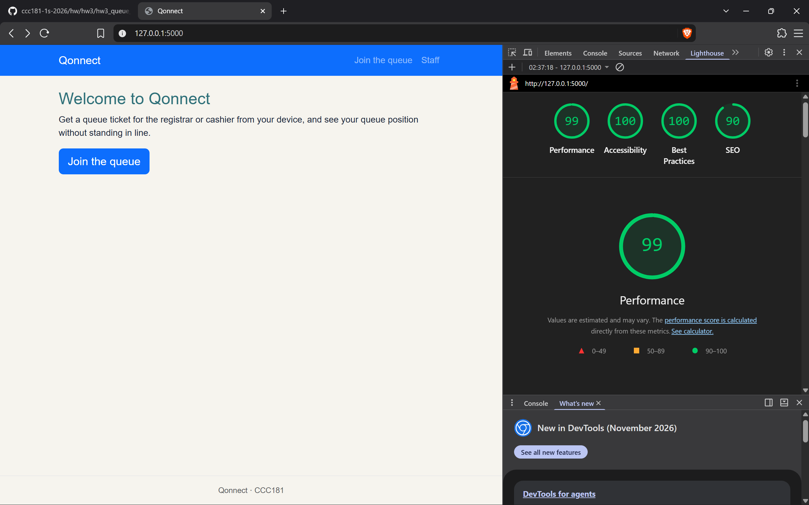
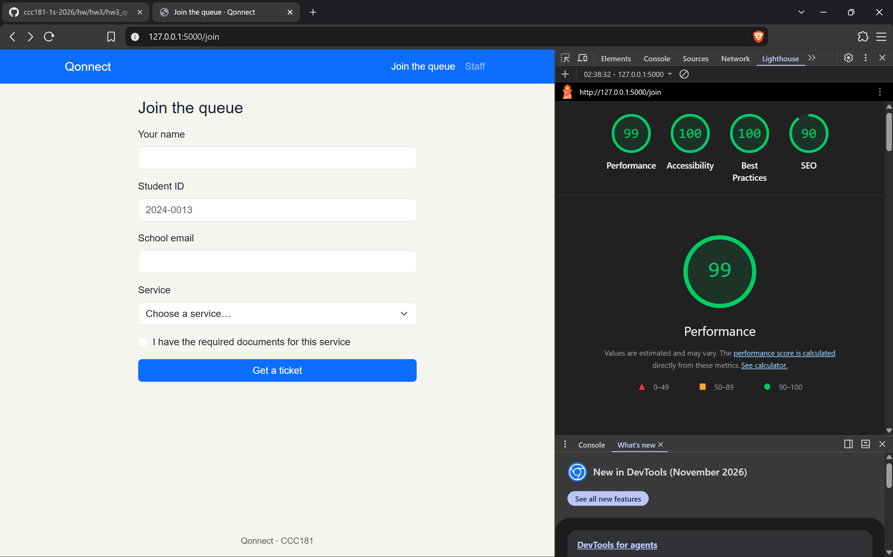
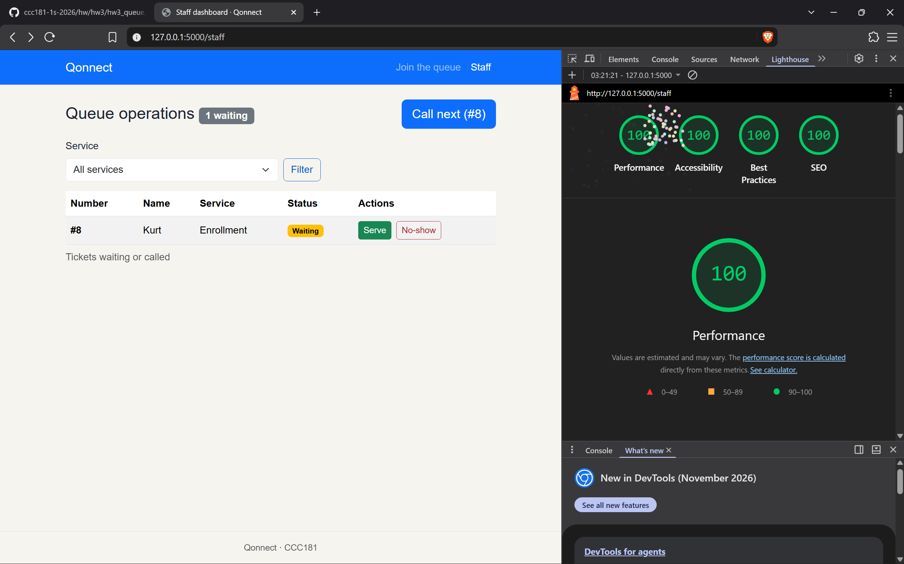

## 9a. Lighthouse

**9c. Manual checklist.** Check each item and mark it ✅ or ❌ (with the fix):

| Check | Join | My place | Staff |
| --- | --- | --- | --- |
| Every input has a visible label | ✅ All four inputs and the select have a `<label>` | n/a (no inputs) | ✅ The service filter has a visible label |
| Error messages say what to do, in text | ✅ e.g. "Enter your 8-digit student ID, for example 2024-0013." | n/a (no form) | n/a (no form errors) |
| Status is shown in words, not only color | n/a (no status shown) | ✅ The badge says "Waiting" or "Called", with a sentence under it | ✅ The badge says "Waiting" or "Called" |
| Text and buttons are readable at 375 px with no sideways page scroll | ✅ | ✅ | ✅ The table scrolls inside its own `table-responsive` wrapper, not the page |
| Buttons are at least about 44 × 44 px on a phone | ✅ The "Get a ticket" button is full width | ❌ "Refresh status" and "Leave the queue" used `btn-sm` (about 31 px tall). Fixed by replacing `btn-sm` with `py-2` | ❌ "Serve" and "No-show" used `btn-sm`. Fixed by replacing `btn-sm` with `py-2` |
| Page has one `<h1>` and headings in order | ✅ | ✅ | ✅ |
| `<html lang="en">` (or your language) is set | ✅ Set once in `base.html` | ✅ | ✅ |

| Screen | Score before | Score after |
|---|---|---|
| Join | 100 | 100 |
| My Place | 94 | 100 |
| Staff | 100 | 100 |

### Join (final score)

### My place (final score)

### Staff (final score)

## 9b. Keyboard only

I tested using only Tab, Shift+Tab, Enter, Space and the arrow keys.

### Join the queue from the home page
- **Skip link:** a "Skip to main content" link appeared on the first Tab, and Enter moved focus to the main content. 
- **Tab order:** skip link, Qonnect, Join the queue, Staff, then the page content. It follows the visual order. 
- **Home page:** I reached the "Join the queue" button and opened the form with Enter. 
- **Form:** I reached the fields in order: name, student ID, email, service, documents checkbox, "Get a ticket". The service dropdown works with the arrow keys, the checkbox works with Space, and Enter on the button submits. 
- **Focus visibility:** a clear outline showed on every control. 
- **Ticket page:** after joining, I could reach "Refresh status", "Home" and "Leave the queue". 

### Staff dashboard
- **Filter:** I reached the service dropdown, changed it with the arrow keys and applied it with Enter on "Filter". 
- **Call:** "Call next" is reachable and works with Enter. The dashboard has no per-row Call button, so "call a ticket" means "Call next", which calls the first waiting ticket. 
- **Serve:** "Serve" and "No-show" are reachable and work with Enter. Their accessible names include the ticket number, for example "Mark ticket 7 as served". 

### What failed and how I fixed it
1. **Focus after a failed submit.** When the Join form showed errors, focus went back to the top of the page, so a keyboard user had to Tab through the navigation to find the error. **Fix:** `main.js` now focuses the first invalid field, so the cursor lands where the first error is.
2. **Small buttons.** "Refresh status", "Leave the queue", "Serve" and "No-show" used `btn-sm` and were too short to tap comfortably. **Fix:** I replaced `btn-sm` with `py-2`. This is a touch issue, not a keyboard issue, but I found it while testing.
3. **Focus after an action.** After "Call next" or "Serve" the page reloads and focus goes back to the top. **Decision:** I left this alone because the skip link lets keyboard users jump straight to the content.

