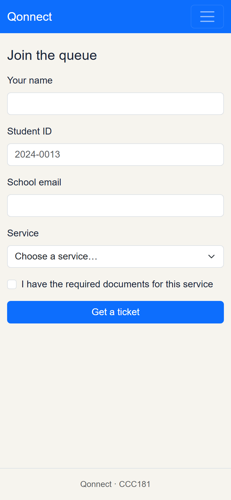
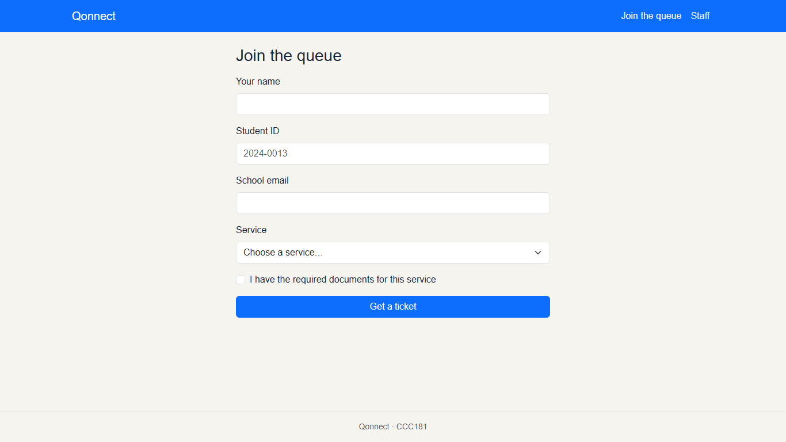
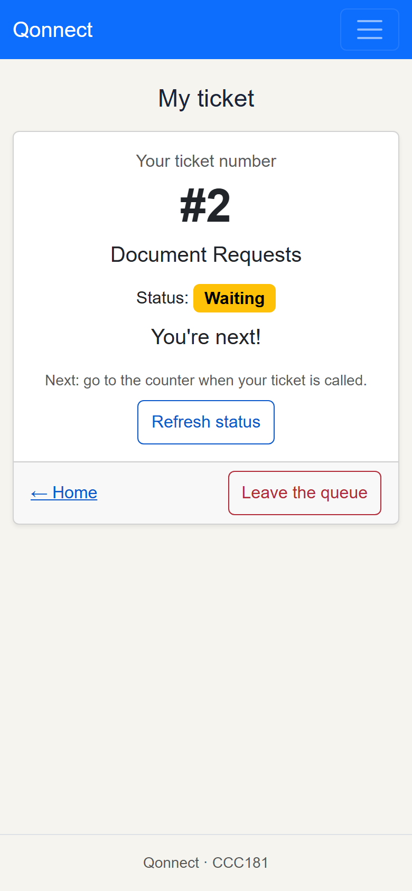
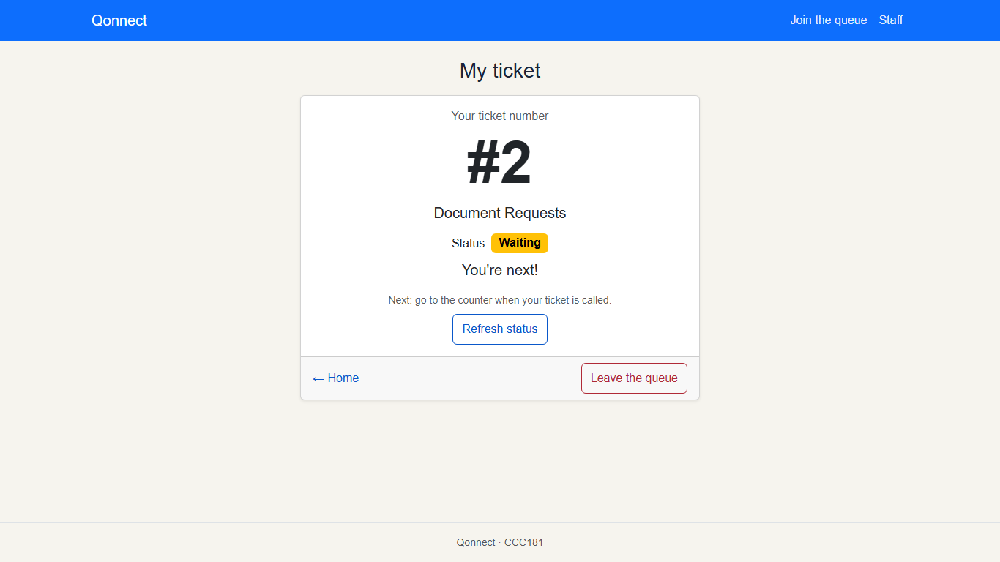
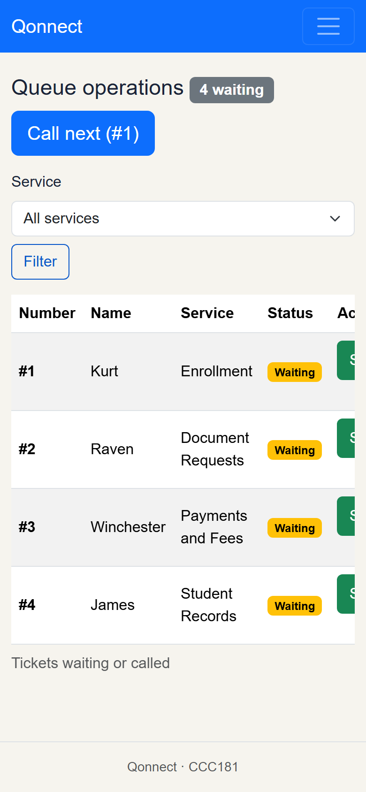
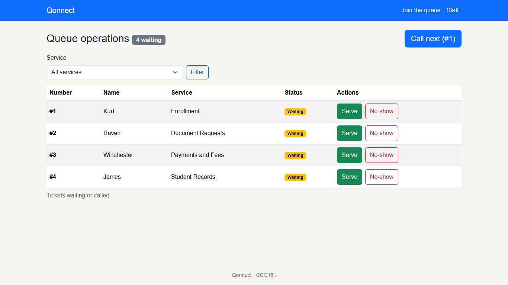
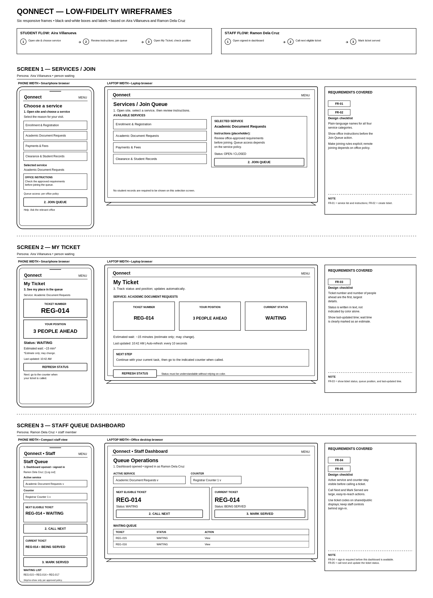
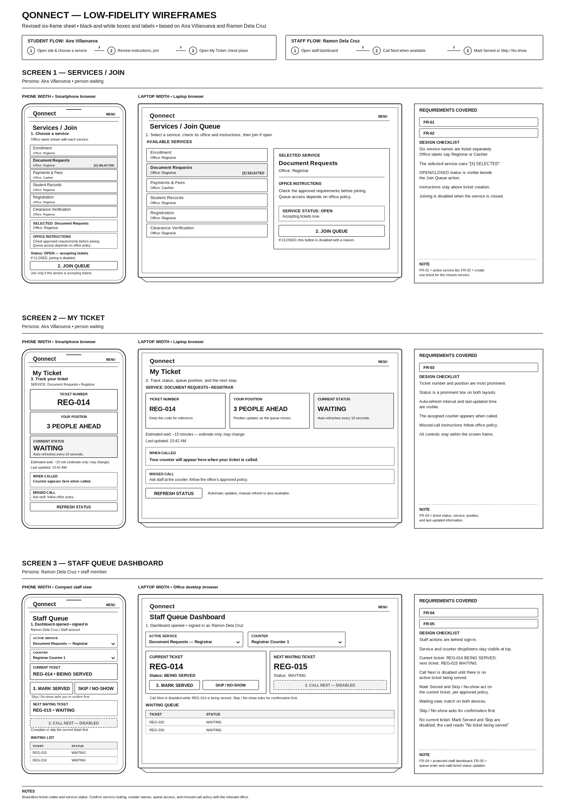
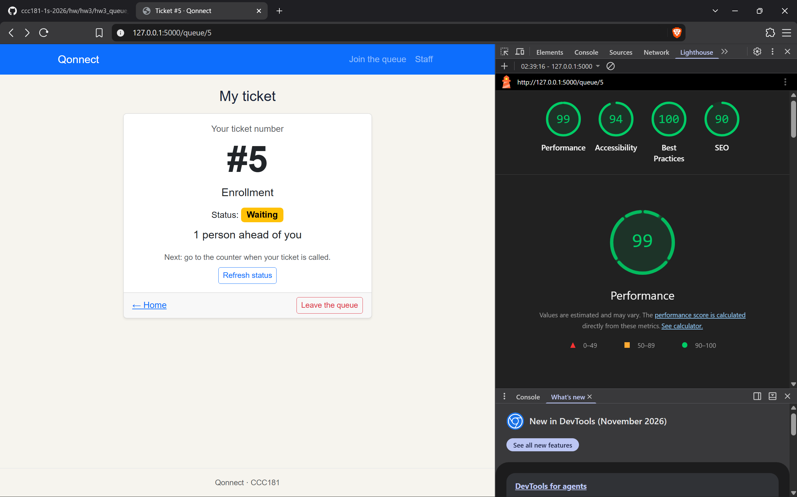

# Week 3 Report: Qonnect Interface

## Title details

| | |
| --- | --- |
| **App name** | Qonnect |
| **Setting** | MSU-IIT Registrar and Cashier offices: students get a queue ticket and track their place in line, and staff call and serve tickets from a dashboard |
| **Full name** | Kurt Renzo H. Azur |
| **Student ID** | 2024-0013 |
| **Section** | CS3 |
| **Date** | October 25, 2026 |
| **Pull request** |  |

## Personas

Full personas: [docs/week3/personas.md](personas.md)

### Aira Villanueva, the person waiting

20-year-old, 2nd-year student who uses her phone between classes.

> "Dugay kaayo ang linya sa cashier. Wala ko kabalo kung kanus-a pa akoang turn."
> *(The cashier line is so long. I don't know when my turn will come.)*

**Top tasks:**
1. Find the right service and read its instructions (FR-01)
2. Get a queue ticket for that service (FR-02)
3. Check her ticket status and how many people are ahead (FR-03)

### Ramon Dela Cruz, the staff member

38-year-old office employee who handles a Registrar or Cashier counter on a desktop computer.

> "Hasol pud minsan sa amoang part nga ga-process mi ug transaction while gatubag sa mga pangutana sa mga estudyante bahin sa ilahang inquiries."
> *(It is sometimes a hassle for us to process transactions while answering students' questions about their inquiries.)*

**Top tasks:**
1. Sign in before using queue controls (FR-04)
2. Call the earliest waiting ticket for the selected service (FR-05)
3. Mark a ticket as served or no-show (FR-05)

## Screens

### Screen 1: Join the queue

Aira uses this screen to choose a service and get a ticket, covering **FR-01** (list of active services) and **FR-02** (create one ticket for the chosen service).

| Phone | Laptop |
| --- | --- |
|  |  |

### Screen 2: My ticket

Aira uses this screen to see her ticket number, status and how many people are ahead of her, covering **FR-03** (ticket status, service and queue position).

| Phone | Laptop |
| --- | --- |
|  |  |

### Screen 3: Staff dashboard

Ramon uses this screen to filter the queue by service, call the next ticket and mark tickets as served or no-show, covering **FR-05** (queue order and valid status updates); **FR-04** (staff sign-in) is not built yet.

| Phone | Laptop |
| --- | --- |
|  |  |

## Design decisions

1. **The ticket number is the largest thing on the My ticket page.** I used Bootstrap's `display-1` size for the number and put the status and "people ahead" sentence right under it. Aira's second rule says the ticket code, status and number of people ahead must be easy to find, because her main frustration is not knowing when her turn will come.

2. **The ticket status updates by itself every 10 seconds.** The page checks `/queue/<id>/status.json` in the background and updates the badge and sentence inside an `aria-live` region, so screen readers announce the change too. The "Refresh status" button is still there as a backup. This follows Aira's third rule: she may be waiting between classes and should not have to keep reloading the page. The status is also written in words ("Waiting", "1 person ahead of you"), not only shown by color, which my self-review flagged.

3. **"Call next" shows which ticket it will call, and is disabled when nobody is waiting.** The button reads "Call next (#1)" so Ramon knows exactly who he is calling before he presses it. Ramon's second rule says the next valid action must be easy to identify and invalid actions must be prevented. My self-review of the staff wireframe also found that buttons stayed active when they should not be.

## Self-review

Full notes: [docs/week3/feedback.md](feedback.md)

| Screen | Main problem in my first wireframes | What I changed |
| --- | --- | --- |
| Services / Join | The selected service was unclear, OPEN/CLOSED status was only a placeholder, and services were not labeled with their office (Registrar or Cashier). | Added an "[X] SELECTED" marker and office labels, listed all six services separately, and showed the service status beside Join Queue, with the button disabled when the service is closed. |
| My ticket | The status was hard to see on the phone, there was no auto-refresh notice, no assigned counter, and no help for a missed call. | Made the status a large box on both layouts, added "Auto-refreshes every 10 seconds", added a "When called" box for the counter and a "Missed call" box. |
| Staff dashboard | One ticket showed as both WAITING and BEING SERVED, all buttons were active at once, there was no Skip / No-show, and the "View" action was unclear. | Split the dashboard into "Current ticket" and "Next waiting ticket", disabled Call Next while a ticket is being served, added Skip / No-show with confirmation, and removed "View". |

**Before:**

**After:**

## Accessibility

Full notes: [docs/week3/accessibility.md](accessibility.md)

| Screen | Lighthouse accessibility before | After |
| --- | --- | --- |
| Join | 100 | 100 |
| My ticket | 94 | 100 |
| Staff | 100 | 100 |

**Most important issue fixed: buttons were too small to tap.** "Refresh status", "Leave the queue", "Serve" and "No-show" used Bootstrap's `btn-sm` class and were only about 31 px tall, below the recommended 44 × 44 px touch target. I replaced `btn-sm` with `py-2` so they are easier to tap on a phone. Keyboard testing also showed that after a failed Join submit, focus jumped back to the top of the page, so `main.js` now moves focus to the first field with an error.

## Usability test

Full notes: [docs/week3/usability-test.md](usability-test.md)

| Task | Finished? | Time | What happened |
| --- | --- | --- | --- |
| 1. "You just arrived. Get in line for Document Requests." | Yes | about 10s | They were able to easily fill-up the form and choose their desired service |
| 2. "How many people are ahead of you? What is your number?" | Yes | about 10s | They were able to easily identify the queue details |
| 3. "Pretend you are the staff member. Call the next person and mark them as served." | Yes | about 10s | They were able to easily manage the customer tickets |

### Improvement/s I made

**Problem seen in the test:** none

**Change:** none

| Before | After |
| --- | --- |
| none | none |

## Reflection

**Hardest part this week:** The hardest part of this week was the frontend stuff. I had a hard time doing them since I couldn't really conceptualize very well the layout of the web app and each pages even though I had plenty of information on how to do it. I still got it nonetheless.

**What will change when the data moves to a database in Week 4:**

- The tickets are stored in a Python list right now, so they disappear when the server restarts. In a database they will stay, and ticket numbers will no longer restart from the sample data.
- Services will become a table with their office, instructions and an open/closed flag. The Join screen can then show the office name, instructions and service status from my revised wireframe, and disable joining when a service is closed.
- Each ticket will store when it was created and last changed, so my ticket can show "Last updated" and a counter can be assigned when the ticket is called.
- Ticket codes can be generated per office (for example REG-014) instead of a plain number.
- Staff accounts and counters will be stored, so I can add the staff sign-in (FR-04) and a counter selector. The staff table can then show ticket codes instead of students' names, which follows Ramon's third rule about privacy.

## Declaration

- **Claude Code (Anthropic):** used to compare my finished app against my revised wireframe, explain Markdown image syntax, make a template for `usability-test.md`, find out why `flask run` failed (I was in the wrong folder), and draft this report. I checked and edited the report before submitting.
- **Bootstrap 5.3** (getbootstrap.com): CSS framework used for the layout, navigation bar, forms and buttons.