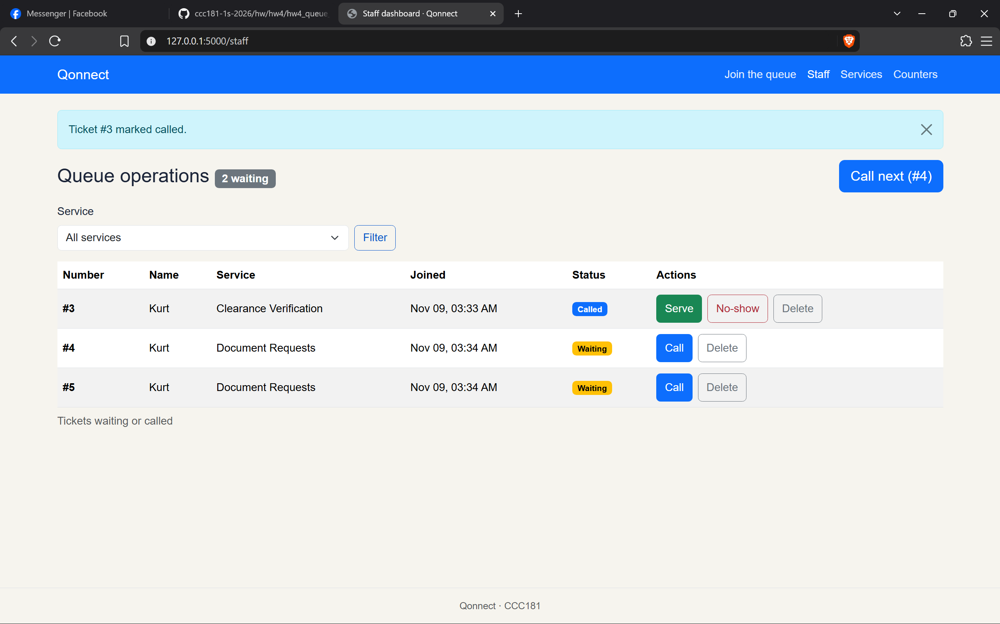
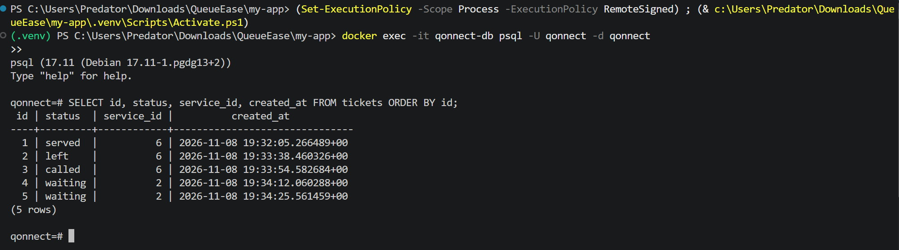
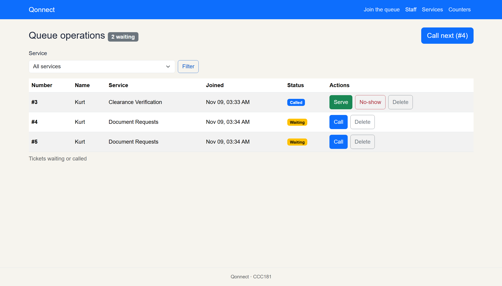
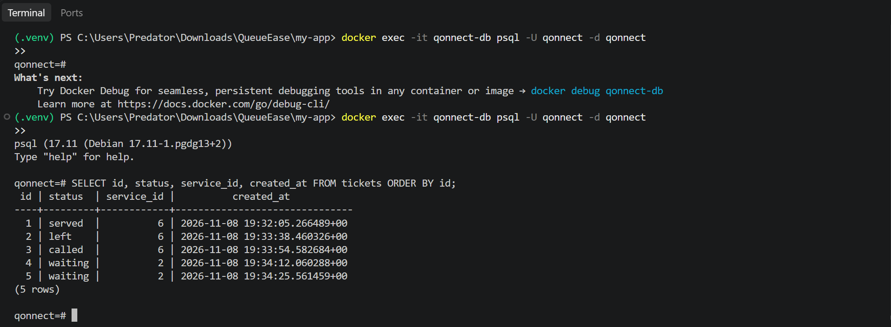

# 11a. Restart test (NFR-01)

**NFR-01:** No ticket, service or status change is lost when the server or the database restarts.

This test checks that the data lives in the PostgreSQL volume (`pgdata`) and not in Flask's memory. If it does, stopping Flask and removing the database container should lose nothing.

## Step 1: Create test data

With Flask running (`flask --app app run --debug`) and the database up, I created five tickets across two services:

| Ticket | Service | Action taken | Final status |
|---|---|---|---|
| #1 | Clearance Verification (id 6) | Called, then served | `served` |
| #2 | Clearance Verification (id 6) | Person left the queue | `left` |
| #3 | Clearance Verification (id 6) | Called | `called` |
| #4 | Document Requests (id 2) | None | `waiting` |
| #5 | Document Requests (id 2) | None | `waiting` |

## Step 2: State before the restart 📷

The staff dashboard shows the active tickets: #3 is **Called**, #4 and #5 are **Waiting**, and the header says "2 waiting" with "Call next (#4)". Tickets #1 and #2 don't show because they are no longer active.



Then I opened psql with `docker exec -it qonnect-db psql -U qonnect -d qonnect` and ran:

```sql
SELECT id, status, service_id, created_at FROM tickets ORDER BY id;
```



```
 id | status  | service_id |          created_at
----+---------+------------+-------------------------------
  1 | served  |          6 | 2026-11-08 19:32:05.266489+00
  2 | left    |          6 | 2026-11-08 19:33:38.460326+00
  3 | called  |          6 | 2026-11-08 19:33:54.582684+00
  4 | waiting |          2 | 2026-11-08 19:34:12.060288+00
  5 | waiting |          2 | 2026-11-08 19:34:25.561459+00
(5 rows)
```

## Step 3: Stop everything

1. Stopped Flask with **Ctrl+C**.
2. Ran `docker compose down`, which stopped and removed the `qonnect-db` container. The named volume `pgdata` stays because I did not use `-v`.
3. Ran `docker compose ps`. It listed no containers, so nothing was running.

## Step 4: Start everything again

1. Ran `docker compose up -d` to create a fresh `qonnect-db` container attached to the same `pgdata` volume.
2. Ran `docker compose ps` until the status showed **healthy**. The compose healthcheck runs `pg_isready` every 5 seconds.
3. Started Flask again with `flask --app app run --debug`.

## Step 5: State after the restart 📷

The staff dashboard is the same as before: #3 **Called**, #4 and #5 **Waiting**, "2 waiting", and "Call next (#4)". The join times are also the same (Nov 09, 03:33 AM and 03:34 AM).



Running the same SQL query gives the same five rows:



```
 id | status  | service_id |          created_at
----+---------+------------+-------------------------------
  1 | served  |          6 | 2026-11-08 19:32:05.266489+00
  2 | left    |          6 | 2026-11-08 19:33:38.460326+00
  3 | called  |          6 | 2026-11-08 19:33:54.582684+00
  4 | waiting |          2 | 2026-11-08 19:34:12.060288+00
  5 | waiting |          2 | 2026-11-08 19:34:25.561459+00
(5 rows)
```

## Result

**Pass.** All five tickets came back after the restart with the same IDs, statuses, services and `created_at` timestamps, down to the microsecond. That includes the finished tickets (#1 served, #2 left), which the dashboard doesn't show. NFR-01 holds: the data is stored in the `pgdata` Docker volume, so it survives both a Flask restart and the database container being removed and recreated.

# 11b. Rebuild from scratch

This test checks that my migrations alone can rebuild the whole database on any computer, with no data and no `db.create_all()`. It deletes all data, so I ran it after the restart test above.

## Commands

```
docker compose down -v
docker compose up -d
flask --app app db upgrade
flask --app app seed
```

1. `docker compose down -v` removed the `qonnect-db` container **and** the `pgdata` volume, so every table and row was deleted.
2. `docker compose up -d` started a new, empty PostgreSQL container. I waited until `docker compose ps` showed **healthy**.
3. `flask --app app db upgrade` ran both migrations in order:

```
INFO  [alembic.runtime.migration] Running upgrade  -> 0d5fd8266d18, Initial schema
INFO  [alembic.runtime.migration] Running upgrade 0d5fd8266d18 -> bf6124cb79a7, add services.active
```

4. `flask --app app seed` printed `Services are ready.` and added the six starting services.

## Checks

| Check | Result |
| --- | --- |
| `\dt` lists every table | `users`, `services`, `tickets`, `counters`, `documents`, `service_documents` and `alembic_version` |
| `SELECT version_num FROM alembic_version;` | `bf6124cb79a7` (the latest migration) |
| `flask --app app db check` | `No new upgrade operations detected.`, so the models and the migrations match exactly |
| `db.create_all()` in the code | Not used anywhere (`git grep create_all` prints nothing) |
| The app opens | yes |
| The Join form lists the services | `Enrollment`, `Document Requests`, `Payments and Fees`, `Student Records`, `Registration`, `Clearance Verification` |
| I can join | yes |

## Result

**Pass.** The two migrations rebuild every table, column and constraint from an empty database, and the seed command adds the starting services. The app opened, showed the services on the Join form, and let me join. No new migration was needed.