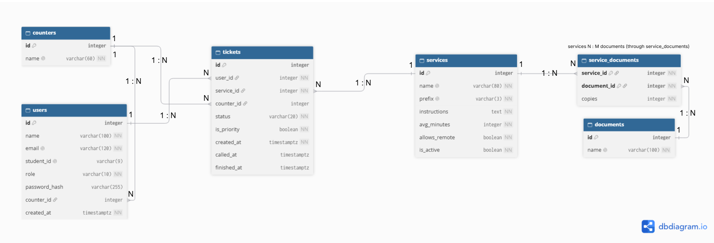
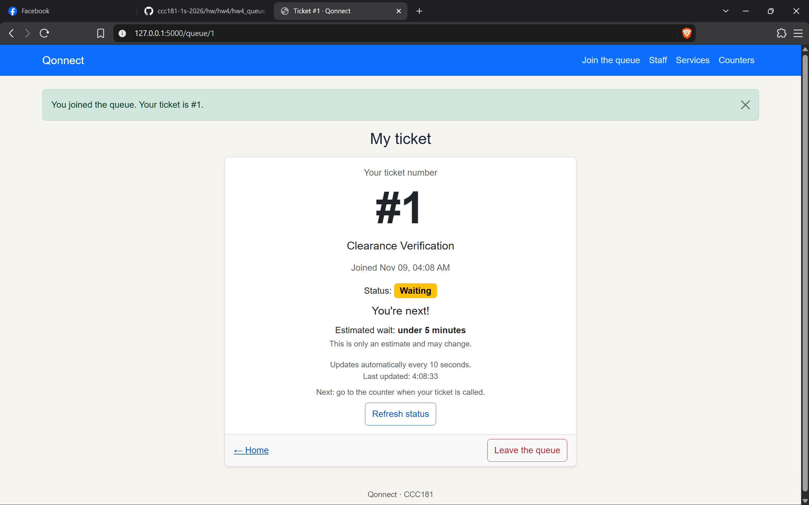
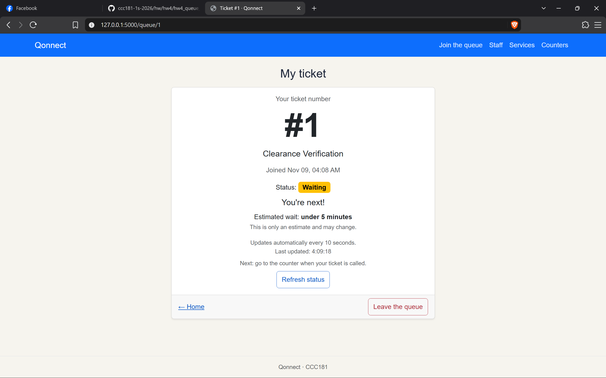
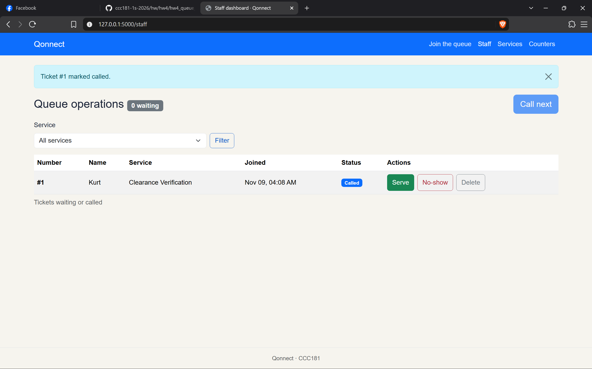
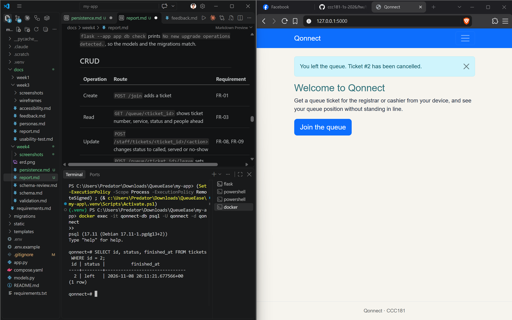
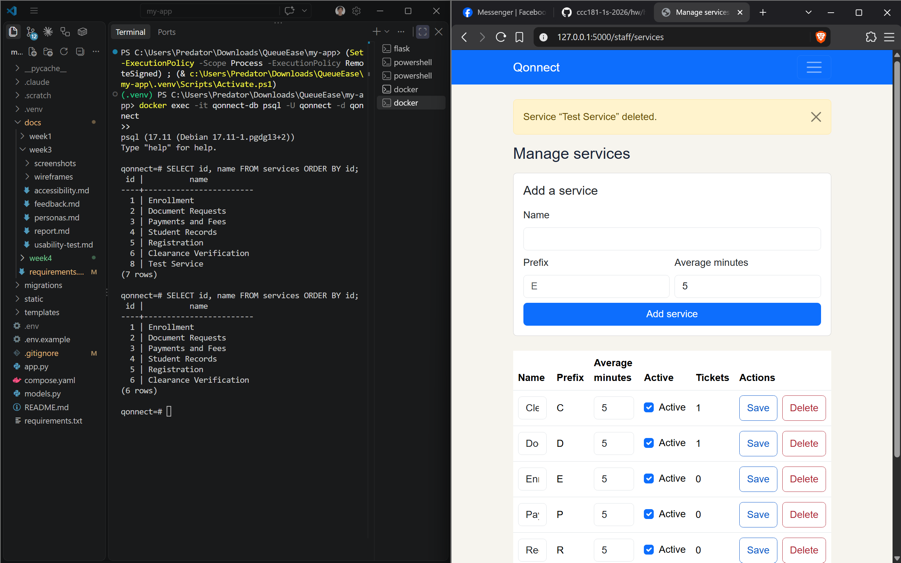
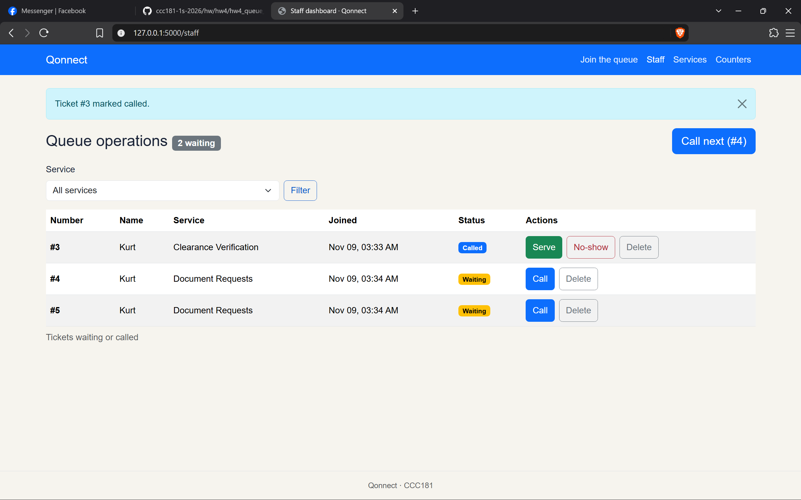
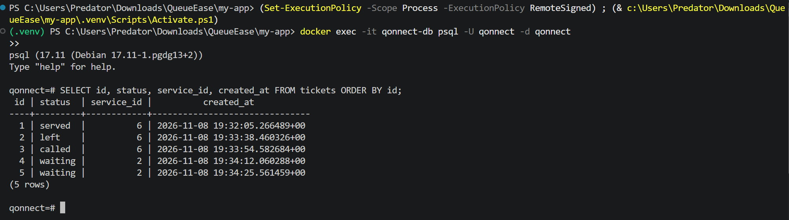
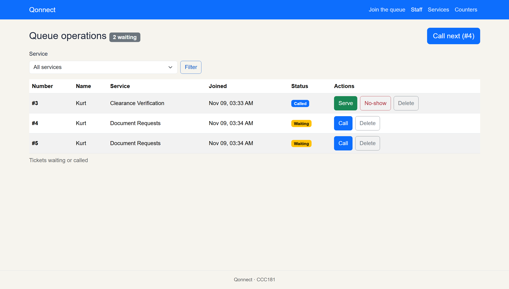
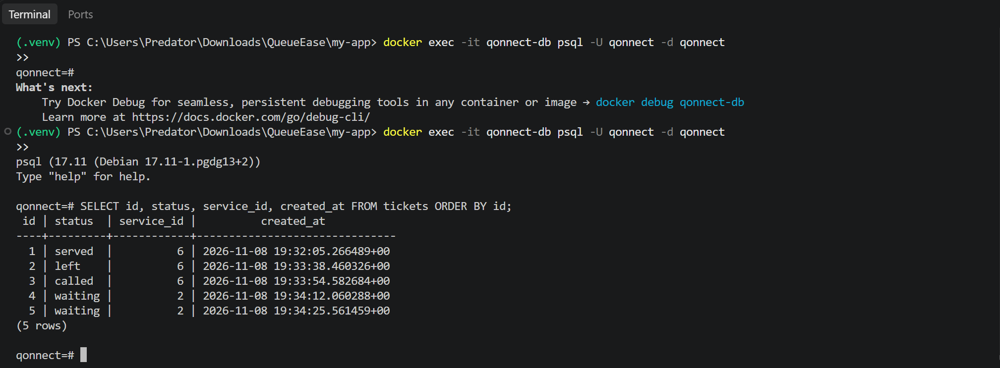

# Week 4 Report: Qonnect Database

## Title details

| | |
| --- | --- |
| **App name** | Qonnect |
| **Setting** | MSU-IIT Registrar and Cashier offices: students get a queue ticket and track their place in line, and staff call and serve tickets from a dashboard |
| **Full name** | Kurt Renzo H. Azur |
| **Student ID** | 2024-0013 |
| **Section** | CS3 |
| **Date** | November 9, 2026 |
| **Pull request** | https://github.com/Draeze83/CCC181/pull/7 |

## Requirements

I wrote **20 functional requirements** (FR-01 to FR-20) and **8 non-functional requirements** (NFR-01 to NFR-08). Full list: [docs/requirements.md](../requirements.md)

**MVP:** FR-01, FR-02, FR-03, FR-04, FR-06, FR-07, FR-08, FR-09, FR-10, FR-11, FR-12, NFR-01, NFR-02, NFR-03, NFR-06, NFR-07, NFR-08

This is the smallest version that still solves the problem. A student can find the right service, get a ticket, follow their place from their phone and leave if they need to. Staff can sign in, keep the service list correct, and move tickets through call, serve and no-show without losing any data.

**Checked with a real person:**

| Who | What they said | What I changed |
| --- | --- | --- |
| 3rd-year student | "Dali lang siya gamiton ug sakto ra" (It's easy to use and just right) | Kept the list as it is, because the student found the join flow easy and didn't ask for anything missing. |

## ERD



- One user has many tickets. Each ticket belongs to exactly one user. (1 : N)
- One service has many tickets. Each ticket belongs to exactly one service. (1 : N)
- One counter has many tickets called to it. Each ticket is called to at most one counter. (1 : N)
- One counter has many staff working at it over time. Each staff member works at one counter or none. (1 : N)
- One service needs many documents, and one document is needed by many services. They are linked through `service_documents`. (N : M)

Full design, types, constraints and delete rules: [docs/week4/schema.md](schema.md)

## Schema

Output of `\d` for each table, from `docker exec qonnect-db psql -U qonnect -d qonnect`:

```
                                       Table "public.users"
    Column     |          Type          | Collation | Nullable |              Default
---------------+------------------------+-----------+----------+-----------------------------------
 id            | integer                |           | not null | nextval('users_id_seq'::regclass)
 name          | character varying(100) |           | not null |
 email         | character varying(120) |           | not null |
 student_id    | character varying(9)   |           |          |
 role          | character varying(10)  |           | not null | 'student'::character varying
 password_hash | character varying(255) |           |          |
 counter_id    | integer                |           |          |
Indexes:
    "users_pkey" PRIMARY KEY, btree (id)
    "users_email_key" UNIQUE CONSTRAINT, btree (email)
    "users_student_id_key" UNIQUE CONSTRAINT, btree (student_id)
Check constraints:
    "ck_users_email_format" CHECK (email::text ~ '^[^@[:space:]]+@[^@[:space:]]+\.[^@[:space:]]+$'::text)
    "ck_users_email_lowercase" CHECK (email::text = lower(email::text))
    "ck_users_role" CHECK (role::text = ANY (ARRAY['student'::character varying, 'staff'::character varying]::text[]))
    "ck_users_staff_has_password" CHECK (role::text = 'student'::text OR password_hash IS NOT NULL)
    "ck_users_student_has_id" CHECK (role::text = 'staff'::text OR student_id IS NOT NULL)
    "ck_users_student_id_format" CHECK (student_id::text ~ '^[0-9]{4}-[0-9]{4}$'::text)
Foreign-key constraints:
    "users_counter_id_fkey" FOREIGN KEY (counter_id) REFERENCES counters(id) ON DELETE SET NULL
Referenced by:
    TABLE "tickets" CONSTRAINT "tickets_user_id_fkey" FOREIGN KEY (user_id) REFERENCES users(id) ON DELETE RESTRICT
```

```
                                       Table "public.services"
    Column     |         Type          | Collation | Nullable |               Default
---------------+-----------------------+-----------+----------+--------------------------------------
 id            | integer               |           | not null | nextval('services_id_seq'::regclass)
 name          | character varying(80) |           | not null |
 prefix        | character varying(3)  |           | not null |
 instructions  | text                  |           | not null | ''::text
 avg_minutes   | integer               |           | not null | 5
 allows_remote | boolean               |           | not null | true
 is_active     | boolean               |           | not null | true
 active        | boolean               |           | not null | true
Indexes:
    "services_pkey" PRIMARY KEY, btree (id)
    "services_name_key" UNIQUE CONSTRAINT, btree (name)
    "services_prefix_key" UNIQUE CONSTRAINT, btree (prefix)
Check constraints:
    "ck_services_avg_minutes" CHECK (avg_minutes > 0)
    "ck_services_prefix" CHECK (prefix::text ~ '^[A-Z]{1,3}$'::text)
Referenced by:
    TABLE "service_documents" CONSTRAINT "service_documents_service_id_fkey" FOREIGN KEY (service_id) REFERENCES services(id) ON DELETE CASCADE
    TABLE "tickets" CONSTRAINT "tickets_service_id_fkey" FOREIGN KEY (service_id) REFERENCES services(id) ON DELETE RESTRICT
```

```
                                       Table "public.tickets"
   Column    |           Type           | Collation | Nullable |               Default
-------------+--------------------------+-----------+----------+-------------------------------------
 id          | integer                  |           | not null | nextval('tickets_id_seq'::regclass)
 user_id     | integer                  |           | not null |
 service_id  | integer                  |           | not null |
 counter_id  | integer                  |           |          |
 status      | character varying(20)    |           | not null | 'waiting'::character varying
 is_priority | boolean                  |           | not null | false
 created_at  | timestamp with time zone |           | not null | now()
 called_at   | timestamp with time zone |           |          |
 finished_at | timestamp with time zone |           |          |
Indexes:
    "tickets_pkey" PRIMARY KEY, btree (id)
    "uq_tickets_one_active" UNIQUE, btree (user_id, service_id) WHERE status::text = ANY (ARRAY['waiting'::character varying, 'called'::character varying]::text[])
Check constraints:
    "ck_tickets_called_after_created" CHECK (called_at >= created_at)
    "ck_tickets_called_first" CHECK ((status::text = ANY (ARRAY['waiting'::character varying, 'left'::character varying]::text[])) OR called_at IS NOT NULL)
    "ck_tickets_finished_after_called" CHECK (finished_at >= called_at)
    "ck_tickets_finished_after_created" CHECK (finished_at >= created_at)
    "ck_tickets_finished_matches_status" CHECK ((status::text = ANY (ARRAY['served'::character varying, 'no-show'::character varying, 'left'::character varying]::text[])) = (finished_at IS NOT NULL))
    "ck_tickets_status" CHECK (status::text = ANY (ARRAY['waiting'::character varying, 'called'::character varying, 'served'::character varying, 'no-show'::character varying, 'left'::character varying]::text[]))
Foreign-key constraints:
    "tickets_counter_id_fkey" FOREIGN KEY (counter_id) REFERENCES counters(id) ON DELETE RESTRICT
    "tickets_service_id_fkey" FOREIGN KEY (service_id) REFERENCES services(id) ON DELETE RESTRICT
    "tickets_user_id_fkey" FOREIGN KEY (user_id) REFERENCES users(id) ON DELETE RESTRICT
```

```
                                   Table "public.counters"
 Column |         Type          | Collation | Nullable |               Default
--------+-----------------------+-----------+----------+--------------------------------------
 id     | integer               |           | not null | nextval('counters_id_seq'::regclass)
 name   | character varying(60) |           | not null |
Indexes:
    "counters_pkey" PRIMARY KEY, btree (id)
    "counters_name_key" UNIQUE CONSTRAINT, btree (name)
Referenced by:
    TABLE "tickets" CONSTRAINT "tickets_counter_id_fkey" FOREIGN KEY (counter_id) REFERENCES counters(id) ON DELETE RESTRICT
    TABLE "users" CONSTRAINT "users_counter_id_fkey" FOREIGN KEY (counter_id) REFERENCES counters(id) ON DELETE SET NULL
```

```
                                    Table "public.documents"
 Column |          Type          | Collation | Nullable |                Default
--------+------------------------+-----------+----------+---------------------------------------
 id     | integer                |           | not null | nextval('documents_id_seq'::regclass)
 name   | character varying(100) |           | not null |
Indexes:
    "documents_pkey" PRIMARY KEY, btree (id)
    "documents_name_key" UNIQUE CONSTRAINT, btree (name)
Referenced by:
    TABLE "service_documents" CONSTRAINT "service_documents_document_id_fkey" FOREIGN KEY (document_id) REFERENCES documents(id) ON DELETE RESTRICT
```

```
            Table "public.service_documents"
   Column    |  Type   | Collation | Nullable | Default
-------------+---------+-----------+----------+---------
 service_id  | integer |           | not null |
 document_id | integer |           | not null |
 copies      | integer |           | not null | 1
Indexes:
    "service_documents_pkey" PRIMARY KEY, btree (service_id, document_id)
Check constraints:
    "ck_service_documents_copies" CHECK (copies > 0)
Foreign-key constraints:
    "service_documents_document_id_fkey" FOREIGN KEY (document_id) REFERENCES documents(id) ON DELETE RESTRICT
    "service_documents_service_id_fkey" FOREIGN KEY (service_id) REFERENCES services(id) ON DELETE CASCADE
```

## Design decisions

1. **I put `is_priority` on `tickets`, not on `users`, and store only yes or no.** FR-19 lets a person with a disability or a pregnant student use a priority lane. That need belongs to one visit, not to the person forever: a pregnant student needs it this semester but not next year. I never store the reason, only the yes/no choice, so the database holds no health information. This keeps NFR-07 (privacy) safe.

2. **Tickets are never really deleted; they change status.** A student who leaves gets `status = 'left'` and a `finished_at` time (FR-06). All three foreign keys on `tickets` are `ON DELETE RESTRICT`, and staff switch a service off instead of deleting it (FR-11). Ramon's daily report (FR-17) counts served, no-show and left tickets per service per day, so losing old rows would make those counts wrong.

3. **Required documents are their own table with a `copies` column, not a text list on `services`.** Aira's main worry is making a second trip because she brought the wrong papers (FR-12). `documents` stores each document's name once, and `service_documents` links it to each service with how many copies that service needs. One document can need 1 copy for one service and 2 for another, so `copies` depends on both keys (2NF), and renaming a document is a one-row update.

## Self-review

Full review: [docs/week4/schema-review.md](schema-review.md)

| # | Problem found | What I changed |
| --- | --- | --- |
| 1 | `users.email` had only NOT NULL and UNIQUE, so `aira@` was accepted, and `Aira@…` and `aira@…` counted as two accounts. | Added `CHECK (email = lower(email))` and an email-format CHECK. |
| 2 | Whether a ticket is finished was stored twice (`status` and `finished_at`) with nothing keeping them in agreement, which would break the FR-17 counts. | Added `CHECK ((status IN ('served','no-show','left')) = (finished_at IS NOT NULL))` and `CHECK (finished_at >= called_at)`. |
| 3 | Three columns had no matching requirement: `avg_minutes`, `copies` and `users.created_at`. | Marked FR-05 as Stores data = Yes, reworded FR-12 to mention copies, and removed `users.created_at`. |
| 4 | A switched-off service could still get a ticket, because a foreign key can't check another row's `is_active`. | Kept this rule in the app: the Join form lists only active services, and `POST /join` checks again before saving. |

## Migrations

| Migration | What it does |
| --- | --- |
| `0d5fd8266d18_initial_schema.py` | Creates all six tables (`users`, `services`, `tickets`, `counters`, `documents`, `service_documents`) with their primary keys, foreign keys, UNIQUE and CHECK constraints, and the partial unique index `uq_tickets_one_active`. |
| `bf6124cb79a7_add_services_active.py` | Adds a boolean `active` column to `services` (NOT NULL, default `true`) so staff can switch a service off without deleting it. |

`flask --app app db check` prints `No new upgrade operations detected.`, so the models and the migrations match.

## CRUD

| Operation | Route | Requirement | Screenshot |
| --- | --- | --- | --- |
| Create | `POST /join` adds a ticket | FR-01 |  |
| Read | `GET /queue/<ticket_id>` shows ticket number, service, status and people ahead | FR-03 |  |
| Update | `POST /staff/tickets/<ticket_id>/<action>` changes status to called, served or no-show | FR-08, FR-09 |  |
| Soft delete | `POST /queue/<ticket_id>/leave` sets `status = 'left'`; the row stays for reports | FR-06 |  |
| Hard delete | `POST /staff/services/<service_id>/delete` removes a service, but only if it has no tickets | FR-11 |  |

## Validation

Full table: [docs/week4/validation.md](validation.md)

Every rule is checked in three layers:

- **Browser:** `required`, `type="email"` and `maxlength` on the Join form stop empty fields, bad emails, names over 100 characters and student IDs over 9 characters before the form is sent.
- **Flask:** `POST /join` checks the same rules again and also rejects a student ID not in `0000-0000` format and a service that doesn't exist or is switched off. Each of these returned **400 BAD REQUEST** with nothing saved, tested with curl so the browser checks were skipped.
- **PostgreSQL:** foreign keys, CHECKs, UNIQUE and NOT NULL reject bad rows even if the app has a bug. I tested each one directly in psql.

No SQL is built with f-strings: `git grep -nE "f[\"'].*(SELECT|INSERT|UPDATE|DELETE)" -- "*.py"` printed nothing.

**Most useful PostgreSQL error:**

```
ERROR: update or delete on table "services" violates foreign key constraint "tickets_service_id_fkey" on table "tickets"
```

I got this from `DELETE FROM services WHERE id = 5;`. It showed me that `ON DELETE RESTRICT` protects the ticket history that FR-17 needs, even when the app doesn't check first. That made me add a friendly check in `POST /staff/services/<id>/delete` telling staff to turn the service off instead.

## Persistence

Full steps: [docs/week4/persistence.md](persistence.md)

**Restart test.** I created five tickets across two services (Clearance Verification and Document Requests): one served, one left, one called and two waiting. Then I stopped Flask, ran `docker compose down`, checked `docker compose ps` showed nothing running, ran `docker compose up -d`, waited for **healthy**, and started Flask again.

**Before restart:**




**After restart:**




All five rows came back with the same `id`, `status`, `service_id` and `created_at`, down to the microsecond.

**Rebuild from scratch.** I ran `docker compose down -v`, `docker compose up -d`, `flask --app app db upgrade` and `flask --app app seed`. Both migrations ran in order (`0d5fd8266d18` then `bf6124cb79a7`), all six tables were created, and the seed added the six starting services. The app opened, the Join form listed the services, and I could join. No new migration was needed, and `db.create_all()` is not used anywhere.

**NFR-01 (no ticket, service or status change is lost when the server or the database restarts): Passed.**

## Reflection

**Hardest this week:** getting the CHECK constraints between `status`, `called_at` and `finished_at` right so a ticket could not be in a state that made no sense.

**Hardest requirement to write in a testable way:** NFR-05, "A first-time student can join the queue from the home page in under 30 seconds on a phone". "Easy to use" can't be tested, so I had to choose a time limit and a starting point I could actually measure with a real person.

**A report Ramon would want:** how many tickets were served, marked no-show, or left before being served, per service, per day (FR-17). This tells him which service needs another counter open during enrollment. I will write that query in the future, grouping by `service_id`, `status` and `created_at AT TIME ZONE 'Asia/Manila'` so days start at midnight in Manila and not 8 a.m.

## Declaration

- **Claude Code (Anthropic):** used to review my schema against my requirements, explain PostgreSQL error messages, check that my migrations rebuild the database, and draft this report and `persistence.md`. I checked and edited everything before submitting.