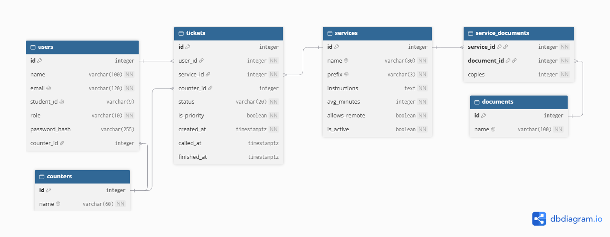

# Qonnect schema design

## 2a. Nouns in the requirements

Only requirements with **Stores data? = Yes** from [requirements.md](../requirements.md).

| Req ID | Requirement | Nouns | Table or column? |
| --- | --- | --- | --- |
| FR-01 | A **student** can join the **queue** for a **service** by entering their **name**, 8-digit **student ID** and school **email**. | student, queue, service, name, student ID, email | users, queue *(not a table)*, services, users.name, users.student_id, users.email. Joining adds a row to tickets. |
| FR-03 | A student can see their **ticket number**, **service**, **status** and how many people are **ahead** of them. | ticket number, service, status, ahead | tickets.id, tickets.service_id → services.name, tickets.status, *(computed)* |
| FR-05 | A student can see an **estimated wait time** that is clearly labelled as an estimate. | estimated wait time | *(computed)*: people ahead × services.avg_minutes. The stored fact is services.avg_minutes. |
| FR-06 | A **student** can leave the **queue** before being called. | student, queue | users, queue *(not a table)*. Leaving sets tickets.status = 'left' and tickets.finished_at. |
| FR-08 | A **staff member** can call the earliest waiting **ticket** for a **service**. | staff member, ticket, service | users (role = 'staff'), tickets, services. "Earliest" comes from tickets.created_at. Calling sets tickets.status and tickets.called_at. |
| FR-09 | A staff member can mark a called **ticket** as **served** or **no-show**. | ticket, served, no-show | tickets, tickets.status, tickets.finished_at |
| FR-10 | A **staff member** must sign in before they can see the **staff dashboard** or change a **ticket**. | staff member, staff dashboard, ticket | users.role, users.password_hash, staff dashboard *(page, not a table)*, tickets |
| FR-11 | A staff member can add, rename and switch off a **service**, and a switched-off service no longer appears on the **Join form**. | service, Join form | services, services.name, services.is_active, Join form *(page, not a table)* |
| FR-12 ★ | A student can read the plain-language **instructions** and **required documents**, and how many **copies** of each, for a **service** before joining its queue. | instructions, required documents, copies, service | services.instructions, documents + service_documents, service_documents.copies, services |
| FR-14 | A student can hold only one **active ticket** per **service** at a time, checked by **student ID**. | active ticket, service, student ID | tickets.status IN ('waiting', 'called') with a partial UNIQUE index, services, users.student_id |
| FR-15 ★ | A staff member can set the **counter** they are working at (for example "Registrar Window 2"), and a called student's **ticket page** shows which counter to go to. | counter, ticket page | counters, users.counter_id, tickets.counter_id, ticket page *(page, not a table)* |
| FR-16 ★ | A staff member can set whether a service allows **remote joining** or **in-person joining** only, and the Join form follows that setting. | remote joining, in-person joining | services.allows_remote |
| FR-17 | A staff member can see, for each **service** and **day**, how many tickets were **served**, marked **no-show** or **left** before being served. | service, day, served, no-show, left | *(computed)*: COUNT of tickets grouped by service_id, created_at date and status |
| FR-18 ★ | Each **ticket number** starts with a **service prefix** (for example D-012 for Document Requests). | ticket number, service prefix | *(computed)*: services.prefix + tickets.id |
| FR-19 ★ | A person with a disability or a pregnant student can join a **priority lane** that is called before the regular line. | priority lane | tickets.is_priority. We store only the yes/no choice for this visit, never the reason (privacy, NFR-07). |

## 2b. Tables and columns

| Table | Qonnect columns |
| --- | --- |
| `users` | id, name, email, student_id, role, password_hash, counter_id |
| `services` | id, name, prefix, instructions, avg_minutes, allows_remote, is_active |
| `tickets` | id, user_id, service_id, counter_id, status, is_priority, created_at, called_at, finished_at |
| `counters` | id, name |
| `documents` | id, name |
| `service_documents` | service_id, document_id, copies |

## 2c. Types and constraints

| Table | Column | PostgreSQL type | Constraint | Why |
| --- | --- | --- | --- | --- |
| users | id | integer, generated | PRIMARY KEY | Generated by the database, never reused |
| users | name | varchar(100) | NOT NULL | Staff need a name to call the student |
| users | email | varchar(120) | NOT NULL UNIQUE, `CHECK (email = lower(email))`, `CHECK (email ~ '^[^@[:space:]]+@[^@[:space:]]+\.[^@[:space:]]+$')` | One account per email. Lowercase only, so Aira@msuiit.edu.ph and aira@msuiit.edu.ph can't be two accounts (UNIQUE is case-sensitive). Rejects badly formed emails such as aira@ or aira@msuiit |
| users | student_id | varchar(9) | UNIQUE, CHECK (student_id ~ '^[0-9]{4}-[0-9]{4}$') | One account per student. Stored as text because it is an ID with a dash and leading zeros (2024-0013)|
| users | role | varchar(10) | NOT NULL DEFAULT 'student', CHECK (role IN ('student', 'staff')) | Only two kinds of user |
| users | password_hash | varchar(255) | *(nullable)* | Only staff sign in (FR-10). Students have no password. We store the hash, never the password |
| users | counter_id | integer | REFERENCES counters(id) ON DELETE SET NULL | The counter a staff member is working at now. Empty for students and for staff not at a counter |
| users | *(table rule)* | | CHECK (role = 'staff' OR student_id IS NOT NULL) | Every student must have a student ID |
| users | *(table rule)* | | CHECK (role = 'student' OR password_hash IS NOT NULL) | Every staff member must be able to sign in |
| services | id | integer, generated | PRIMARY KEY | Generated by the database, never reused |
| services | name | varchar(80) | NOT NULL UNIQUE | Two services with the same name would confuse students |
| services | prefix | varchar(3) | NOT NULL UNIQUE, CHECK (prefix ~ '^[A-Z]{1,3}$') | D-012 must point to exactly one service (FR-18) |
| services | instructions | text | NOT NULL DEFAULT '' | Plain-language steps can be long (FR-12) |
| services | avg_minutes | integer | NOT NULL DEFAULT 5, CHECK (avg_minutes > 0) | Used for the wait estimate (FR-05). Rejects impossible values |
| services | allows_remote | boolean | NOT NULL DEFAULT true | Remote or in-person joining only (FR-16) |
| services | is_active | boolean | NOT NULL DEFAULT true | Switch a service off without deleting its old tickets (FR-11) |
| tickets | id | integer, generated | PRIMARY KEY | Generated by the database, never reused, so two students never get the same number (NFR-02) |
| tickets | user_id | integer | NOT NULL REFERENCES users(id) ON DELETE RESTRICT | Every ticket belongs to one student |
| tickets | service_id | integer | NOT NULL REFERENCES services(id) ON DELETE RESTRICT | No ticket for a missing service |
| tickets | counter_id | integer | REFERENCES counters(id) ON DELETE RESTRICT | Empty until called; then shows the student where to go (FR-15) |
| tickets | status | varchar(20) | NOT NULL DEFAULT 'waiting', CHECK (status IN ('waiting', 'called', 'served', 'no-show', 'left')) | Only waiting, called, served, no-show, left |
| tickets | is_priority | boolean | NOT NULL DEFAULT false | Priority lane for this visit only (FR-19) |
| tickets | created_at | timestamptz | NOT NULL DEFAULT now() | Time zone safe; set by the database. Orders the queue |
| tickets | called_at | timestamptz | CHECK (called_at >= created_at) | Empty until called; a ticket can't be called before it exists |
| tickets | finished_at | timestamptz | CHECK (finished_at >= created_at) | When it was served, marked no-show or left (FR-17) |
| tickets | *(table rule)* | | CHECK (status IN ('waiting', 'left') OR called_at IS NOT NULL) | Called, served and no-show tickets must have been called first (FR-13) |
| tickets | *(table rule)* | | CHECK ((status IN ('served', 'no-show', 'left')) = (finished_at IS NOT NULL)) | A ticket has a finish time exactly when it is served, no-show or left, so status and finished_at can't disagree (FR-17 counts) |
| tickets | *(table rule)* | | CHECK (finished_at >= called_at) | A ticket can't finish before it was called. Passes when called_at is empty (a student who left while waiting) |
| tickets | *(table rule)* | | UNIQUE (user_id, service_id) WHERE status IN ('waiting', 'called') *(partial unique index)* | One active ticket per student per service (FR-14) |
| counters | id | integer, generated | PRIMARY KEY | Generated by the database, never reused |
| counters | name | varchar(60) | NOT NULL UNIQUE | "Registrar Window 2" must mean one place |
| documents | id | integer, generated | PRIMARY KEY | Generated by the database, never reused |
| documents | name | varchar(100) | NOT NULL UNIQUE | Each document is written once and shared by services |
| service_documents | service_id | integer | NOT NULL REFERENCES services(id) ON DELETE CASCADE | Part of the key; links to the service |
| service_documents | document_id | integer | NOT NULL REFERENCES documents(id) ON DELETE RESTRICT | Part of the key; links to the document |
| service_documents | copies | integer | NOT NULL DEFAULT 1, CHECK (copies > 0) | How many copies this service needs of this document (FR-12) |
| service_documents | *(table rule)* | | PRIMARY KEY (service_id, document_id) | A service can't list the same document twice |

**Required constraints used:** PRIMARY KEY (every `id`, plus the composite key on `service_documents`), FOREIGN KEY (`tickets.user_id`, `tickets.service_id`, `tickets.counter_id`, `users.counter_id`, `service_documents.service_id`, `service_documents.document_id`), NOT NULL, UNIQUE (`users.email`, `services.name`, and others), CHECK (`tickets.status`, `services.avg_minutes`, and others), and `timestamptz` (`created_at`, `called_at`, `finished_at`). No dates, times or numbers are stored as text.

## 2d. ERD

**Relationships:**

- One user has many tickets. Each ticket belongs to exactly one user. (1 : N)
- One service has many tickets. Each ticket belongs to exactly one service. (1 : N)
- One counter has many tickets called to it. Each ticket is called to at most one counter. (1 : N)
- One counter has many staff working at it over time. Each staff member works at one counter or none. (1 : N)
- One service needs many documents, and one document is needed by many services. They are linked through `service_documents`. (N : M)

**Delete rules:**

| Foreign key | On delete | Why |
| --- | --- | --- |
| tickets.user_id → users | RESTRICT | Old tickets are needed for the daily reports (FR-17), so a user with tickets can't be deleted. |
| tickets.service_id → services | RESTRICT | Deleting a service must not delete its old tickets. Staff switch it off with `is_active` instead (FR-11). |
| tickets.counter_id → counters | RESTRICT | A ticket keeps a record of where it was served. A counter that has served tickets can't be deleted. |
| users.counter_id → counters | SET NULL | If a counter is removed, the staff member is simply no longer assigned to one. The person still exists. |
| service_documents.service_id → services | CASCADE | A requirement link means nothing without its service. In practice, services are switched off, not deleted. |
| service_documents.document_id → documents | RESTRICT | Stops a document from silently disappearing from every service that needs it. Remove it from those services first. |

## 2e. Normalization check

**1. One value per cell (1NF): does any column hold a list?**

No. Every column holds one value per row. The one place a list could have appeared is the documents a service requires (for example "Valid school ID, Enrollment form"). I did not store that as a text column in `services`. Each document is its own row in `documents`, and `service_documents` links a service to each document it needs. `services.instructions` is one block of plain-language text shown to the student, not a list of values the app queries or updates item by item. `tickets.status` holds exactly one of five values.

**2. Depends on the whole key (2NF): in each join table, does every extra column depend on both keys?**

Yes, so there is no 2NF problem and nothing to split. The only join table is `service_documents`, with the composite key (`service_id`, `document_id`). Its one extra column is `copies`, the number of copies of that document that this service requires. It depends on both keys: the same document can need 1 copy for one service and 2 for another, and the same service can need different numbers of copies for different documents. A column such as `document_name` would depend on `document_id` only and would break 2NF, so the document's name is stored in `documents.name` instead.

**3. No hidden copies (3NF): would I ever have to update the same fact in more than one row?**

No. Each fact is stored once, and other tables point to it by key:

- A person's name, email and student ID live only in `users`. `tickets` stores only `user_id`, so a corrected email is changed in one row.
- A service's name, prefix, instructions and average minutes live only in `services`. `tickets` and `service_documents` store only `service_id`, so renaming a service is a one-row update.
- A counter's name lives only in `counters`. `users.counter_id` and `tickets.counter_id` both point to it, so renaming "Registrar Window 2" is a one-row update. `tickets.counter_id` is a different fact from `users.counter_id` (where this ticket was called, versus where the staff member works now), so it is not a copy.
- A document's name lives only in `documents`.
- No computed values are stored. Position in line, people ahead, estimated wait, the ticket number shown to the student (service prefix plus ticket id) and the daily report counts are all calculated from the stored facts when needed.

No data was needed to be split into extra tables as a result of these checks.